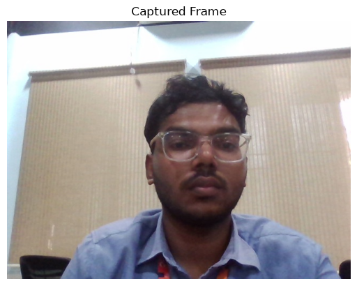
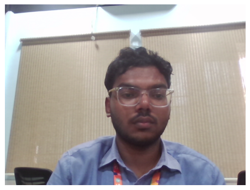
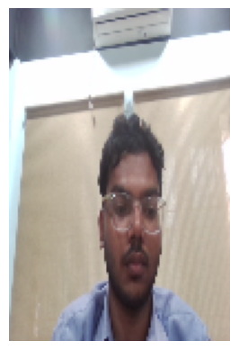
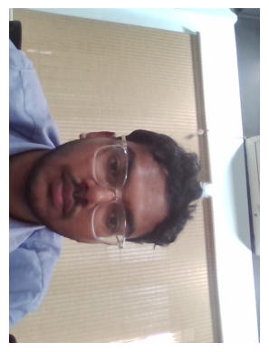

# Image Capture and Video Processing Using OpenCV

**Name:** Jeyaarikaran.P  
**Register Number:** 212224240064  

---

## Aim
To write a Python program using OpenCV to capture an image from the webcam and perform the following operations:
1. Write the frame as a JPG file
2. Display the video
3. Display the video by resizing the window
4. Rotate and display the video

---

## 🛠️ Software Used
- Anaconda – Python 3.7
- Jupyter Notebook / VS Code
- OpenCV (cv2)

---

## ⚙️ Algorithm

### Step 1:
Import the required libraries and initialize the webcam using `cv2.VideoCapture()`.

### Step 2:
Capture frames continuously from the webcam.

### Step 3:
Save a frame as a JPG image using `cv2.imwrite()`.

### Step 4:
Display the live video stream using `cv2.imshow()`.

### Step 5:
Resize the frame and rotate it using OpenCV functions, then display the processed frames.

---

## 💻 Program

**Developed By:**
- **Name:** Jeyaarikaran.P
- **Register No:** 212224240064

---

### i) Write the frame as a JPG file

#### Standard OpenCV (cv2):
```python
import cv2

# Initialize the webcam
videoCaptureObject = cv2.VideoCapture(0)

# Capture a single frame
ret, frame = videoCaptureObject.read()

# Save the captured frame as a JPG file
if ret:
    cv2.imwrite("captured_image.jpg", frame)

# Release the camera and close all windows
videoCaptureObject.release()
cv2.destroyAllWindows()
```

#### Jupyter Notebook (using Matplotlib):
```python
import cv2
import matplotlib.pyplot as plt

# Capture frame from webcam
cap = cv2.VideoCapture(0)
ret, frame = cap.read()
if ret:
    cv2.imwrite("captured_image.jpg", frame)
cap.release()

# Read and display the saved image
captured_image = cv2.imread('captured_image.jpg')
plt.imshow(captured_image[:, :, ::-1])
plt.title('Captured Frame')
plt.axis('off')
plt.show()
```

---

### ii) Display the video

#### Standard OpenCV (cv2):
```python
import cv2

# Initialize the webcam
videoCaptureObject = cv2.VideoCapture(0)

while True:
    ret, frame = videoCaptureObject.read()
    if not ret:
        break
    
    # Display the live video stream
    cv2.imshow('Live Video', frame)
    
    # Press 'q' key on keyboard to stop the video
    if cv2.waitKey(1) & 0xFF == ord('q'):
        break

videoCaptureObject.release()
cv2.destroyAllWindows()
```

#### Jupyter Notebook (using Matplotlib & IPython Display):
```python
import cv2
import matplotlib.pyplot as plt
from IPython.display import clear_output
import time

cap = cv2.VideoCapture(0)

for i in range(50):
    ret, frame = cap.read()
    if not ret:
        break
    frame_rgb = cv2.cvtColor(frame, cv2.COLOR_BGR2RGB)
    clear_output(wait=True)
    plt.imshow(frame_rgb)
    plt.title('Live Video Stream')
    plt.axis('off')
    plt.show()
    time.sleep(0.05)

cap.release()
```

---

### iii) Display the video by resizing the window

#### Standard OpenCV (cv2):
```python
import cv2

# Initialize the webcam
videoCaptureObject = cv2.VideoCapture(0)

while True:
    ret, frame = videoCaptureObject.read()
    if not ret:
        break
    
    # Resize the frame to 640x480 resolution
    resized_frame = cv2.resize(frame, (640, 480))
    
    # Display the resized video window
    cv2.imshow('Resized Video (640 x 480)', resized_frame)
    
    # Press 'q' key on keyboard to stop the video
    if cv2.waitKey(1) & 0xFF == ord('q'):
        break

videoCaptureObject.release()
cv2.destroyAllWindows()
```

#### Jupyter Notebook (using Matplotlib & IPython Display):
```python
import cv2
import matplotlib.pyplot as plt
from IPython.display import clear_output
import time

cap = cv2.VideoCapture(0)

for i in range(50):
    ret, frame = cap.read()
    if not ret:
        break
    # Resize the frame to (640, 480)
    resized_frame = cv2.resize(frame, (640, 480))
    frame_rgb = cv2.cvtColor(resized_frame, cv2.COLOR_BGR2RGB)
    clear_output(wait=True)
    plt.imshow(frame_rgb)
    plt.title('Resized Video (640 x 480)')
    plt.axis('off')
    plt.show()
    time.sleep(0.05)

cap.release()
```

---

### iv) Rotate and display the video

#### Standard OpenCV (cv2):
```python
import cv2

# Initialize the webcam
videoCaptureObject = cv2.VideoCapture(0)

while True:
    ret, frame = videoCaptureObject.read()
    if not ret:
        break
    
    # Rotate the frame 90 degrees clockwise
    rotated_frame = cv2.rotate(frame, cv2.ROTATE_90_CLOCKWISE)
    
    # Display the rotated video window
    cv2.imshow('Rotated Video (90 Clockwise)', rotated_frame)
    
    # Press 'q' key on keyboard to stop the video
    if cv2.waitKey(1) & 0xFF == ord('q'):
        break

videoCaptureObject.release()
cv2.destroyAllWindows()
```

#### Jupyter Notebook (using Matplotlib & IPython Display):
```python
import cv2
import matplotlib.pyplot as plt
from IPython.display import clear_output
import time

cap = cv2.VideoCapture(0)

for i in range(50):
    ret, frame = cap.read()
    if not ret:
        break
    # Rotate the frame 90 degrees clockwise
    rotated_frame = cv2.rotate(frame, cv2.ROTATE_90_CLOCKWISE)
    frame_rgb = cv2.cvtColor(rotated_frame, cv2.COLOR_BGR2RGB)
    clear_output(wait=True)
    plt.imshow(frame_rgb)
    plt.title('Rotated Video (90° Clockwise)')
    plt.axis('off')
    plt.show()
    time.sleep(0.05)

cap.release()
```

---

## Output

### i) Write the frame as JPG image
Captured image is saved as `captured_image.jpg`



---

### ii) Display the video
Live webcam video is displayed



---

### iii) Display the video by resizing the window
Video is shown in resized resolution (640 × 480)



---

### iv) Rotate and display the video
Video is displayed after rotation (90° clockwise)



---

## Result
Thus, the image is successfully captured from the webcam and various video processing operations such as saving, displaying, resizing, and rotating are performed using OpenCV.

